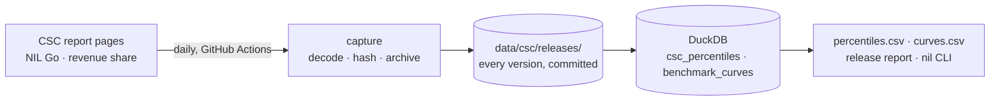

# College_Football_NIL_Models

The College Sports Commission publishes what college athletes are paid, but not as data. Its
[NIL Go](https://www.collegesportscommission.org/nil-go-transparency-report/) and
[revenue-share](https://www.collegesportscommission.org/school-revenue-share-compensation-report/) reports
are dropdowns over base64 blobs, and nobody keeps old versions. This repository turns them into tables you
can query, captures every release daily, and builds an **offer benchmark** on top:

```text
$ nil benchmark --sport Football --position Linebacker --cohort A4 --revenue-share 150000 --nil 40000

report         cohort                          among                   n  amount    percentile    published percentiles
-------------  ------------------------------  --------------------  ---  --------  ------------  -------------------------
revenue_share  men's Football Linebacker · A4  paid athletes         643  $150,000  59th          between the 50th and 75th
revenue_share  men's Football Linebacker · A4  everyone rostered     858  $150,000  70th          between the 63rd and 75th
nil_go         men's Football Linebacker · A4  athletes with a deal  391  $40,000   62nd          between the 50th and 75th
```

## How it works



- **Capture.** `nil refresh` fetches both pages, decodes the embedded payloads, and stores any payload it
  has not seen as a new release, archived in `data/csc/releases/`. `.github/workflows/capture.yml` runs
  it daily and commits only when something changed.
- **Check.** Every release must pass its checks: monotone percentiles, suppression thresholds, the
  With $0 vs Without $0 identity, football coverage, and SVG vs table data.
- **Benchmark.** A curve per cohort through the published percentiles. It is validated out of sample
  (within about 2 percentile points on revenue share) and stored as a value at every whole percentile.

The two reports are never compared or combined.

**Dashboard:** [College Athlete Pay Benchmarks](https://claude.ai/artifact/HddyzuWahnocHREU1FsbXD) opens on six
findings worked out from the latest release (who gets paid, the position most often paid, the floor on what each A4
program pays, the top of the quarterback market, flat payment tiers, roster surplus), then has an offer check that
reads an amount off each report's curve, football pay by position with A4 and non-A4 paid shares side by side,
basketball by conference, a searchable table of every cohort, roster market value against on-field value, and
the method. It is one self-contained HTML file in [Board UI](https://www.boardui.com)'s look, built from
`dashboard/index.html` and `data/dashboard/*.json` by `python dashboard/build_html.py`; `nil refresh` (or
`nil dashboard-data`) rewrites the data with each new release. The same page also runs in the
[hosted dashboard](https://claude.ai/artifact/QbV3GphFyEs3L5mZNhggdU); re-upload the data files there after a release.

**Project map:** [NIL Project Map](https://claude.ai/artifact/5YqTJbgYPaGe4WZ8NvwBcm) walks through every step
of the project, with its results and the decisions behind them.

## Setup

```bash
uv sync
uv run pytest
uv run nil refresh --offline     # build data/nil.duckdb from the archived releases
```

## Commands

```bash
nil refresh                      # fetch both pages; store, check, fit; export if a release is new
nil refresh --offline --export   # rebuild from the archive and rewrite every export
nil benchmark --sport Football --position Quarterback --cohort A4 --revenue-share 400000 --nil 50000
nil curve --sport Football --position Quarterback --cohort A4 [--report nil_go]
nil query "SELECT position, value_usd FROM csc_latest WHERE sport = 'Football' AND cohort = 'A4'
           AND population = 'paid' AND percentile = 50 ORDER BY value_usd DESC"
nil triangulate                  # floors and calibrated tails for football totals
nil claims my_claims.csv         # credibility of reported deals (columns: data/claims/template.csv)
nil simulate                     # test the estimation methods on synthetic markets (about 2 minutes)
nil players                      # CFBD rosters, recruiting, portal, production; A4 roster market values (needs CFBD_API_KEY in .env)
nil dashboard-data               # rewrite data/dashboard/*.json for the dashboard
nil status
```

`--cohort` is `A4` or `Non-A4`, or `ACC`, `Big Ten`, `Big 12` or `SEC` for basketball. `--gender men|women`
is needed where a sport has both.

## Files

| Path | What |
|---|---|
| `data/csc/releases/` | every release seen, `report_firstseen_sha.json.gz`, never rewritten |
| `data/csc/percentiles.csv` | latest release of each report, one row per cohort |
| `data/benchmark/curves.csv` | benchmark curves, p1–p99 per cohort and population |
| `reports/release_DATE.md` | checks, football in each report, and benchmark validation for a release |
| `docs/ARCHITECTURE.md` | sources, schema, pipeline, checks, rules for using the numbers |
| `docs/BENCHMARK.md` | the curve method and its validation |
| `docs/SCHOOL_LAYER.md` | research: proxies for school-level pay, which the CSC does not publish |
| `data/players/roster_values_2026.csv` | each A4 roster's revenue-share market value with its range (team totals only) |
| `docs/ESTIMATION.md` | the estimation approach: floors, calibrated tails, rank-to-pay transport, claims as anchors, credibility tests, and the simulation that validates them |
| `docs/MARKET_RESEARCH.md` | research: Dropback and the market for NIL intelligence tools; where this data fits |

The rating model this started next to is
[CollegeFootballRatings2026](https://github.com/RohanRepala0/CollegeFootballRatings2026).
