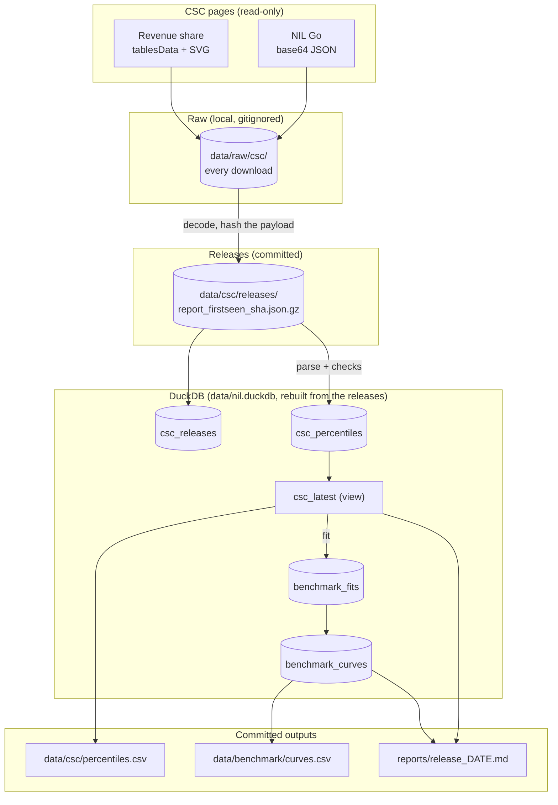

# Architecture

A point-in-time store of the College Sports Commission's compensation reports, the daily pipeline that
keeps it, and the offer benchmark built on it.

## Why this exists

- **The data is not published as data.** Neither page has an HTML table, CSV or API. NIL Go's numbers
  are base64 JSON inside a base64 `<script src="data:...">`. Revenue share's are a JSON table model plus
  SVG images of the same tables. A reader sees one dropdown selection at a time. Here every cell of
  every cohort is a row you can query.
- **Nobody keeps old versions.** The CSC says the data "may be updated as additional information is
  received". The Wayback Machine has no captures of either page (checked 2026-10-30). The daily
  pipeline makes this repository the revision history.
- **Each report stands alone.** NIL Go and revenue share cover different athletes, windows, position
  labels and rounding. Nothing here compares or combines them.
- **There is no school or player grain.** Every number is a cohort percentile.
  [`SCHOOL_LAYER.md`](SCHOOL_LAYER.md) is the research on proxies for a school layer.

## Sources

| | NIL Go | Revenue share |
|---|---|---|
| Page | [nil-go-transparency-report](https://www.collegesportscommission.org/nil-go-transparency-report/) | [school-revenue-share-compensation-report](https://www.collegesportscommission.org/school-revenue-share-compensation-report/) |
| What | Third-party NIL deals submitted and cleared through NIL Go | Institutional revenue-share payments reported to CAPS |
| Delivered as | `var B64="..."` → JSON `{percentileLabels, sports[{name, grouped, horizons[{label, start, end, thresholds, bands \| rows}]}]}` | `const sportsData` (index) → `const tablesData` (tables with group spans) and `const TABLE_SVGS` (the same tables as images) |
| Page filters | Sport, then position for football | Gender, sport, position, $0 amounts. No school filter. |
| Coverage (2026-10-30) | 36 sports, 100 cohorts | 39 sports (16 men's, 23 women's) in 52 tables, 146 cohorts |
| Cohorts | football: 12 positions × A4 / Non-A4; basketball: ACC, Big Ten, Big 12, SEC, Non-A4; others: A4 / Non-A4 | football: 12 positions × A4 / Non-A4; basketball: by conference; others: A4 / Non-A4 |
| Population | rostered athletes with at least one cleared deal (`deal_holders`) | everyone rostered ("With $0", `all_rostered`) and only the paid ("Without $0", `paid`) |
| Football window | deals cleared Jan 1 – Sep 30, 2026 | payments in calendar 2026, agreements as of Sep 30, 2026, performance incentives counted as payable |
| Values | unrounded dollars, full contract value, not annualized | text rounded to $500 |
| Suppression | n ≥ 100 for p90 and p10, ≥ 40 for p75 and p25, ≥ 10 for p50 (published) | the same cells are hidden (checked) |
| Oddities | six cohorts publish `count: "<10"` (kept as `n_text`) | an empty `mixed` gender key |

## Layers

**Release identity.** A release is the sha256 of the decoded payload, not of the HTML, which also
carries form nonces and asset versions. Refetching an unchanged page only moves `last_seen_at`.

**Point in time.** The release in effect at time *t* is the latest one with `first_seen_at` ≤ *t*.
`first_seen_at` is when this repository first saw it, not when the CSC posted it. The first release
is stamped 2026-10-30 although the CSC posted it earlier.

**Rebuildable.** The DuckDB file is not committed. `nil refresh --offline` rebuilds it from the
archived releases, re-parsing each with the current code, so parser fixes reach old releases.

## The pipeline

`.github/workflows/capture.yml` runs `nil refresh` every day at 13:17 UTC:

1. Load every archived release.
2. Fetch both pages. A payload never seen before is a new release: archived first, then parsed.
3. Check the latest release of each report and fit the benchmark to it.
4. If something is new, rewrite `data/csc/percentiles.csv`, `data/benchmark/curves.csv` and
   `reports/release_<date>.md`, and commit them with the archive file.

A day with no change commits nothing. A failed check or a page without its payload fails the run, so
GitHub emails the owner. A new release is still committed first, and the raw pages are kept as a
30-day workflow artifact.

## Schema

`csc_releases`: one row per distinct payload: `report`, `payload_sha256`, `url`, `first_seen_at`,
`last_seen_at`, `archive_path`, `n_cohorts`.

`csc_percentiles`: one row per published cell. A cohort is
`(report, gender, sport, position, cohort, population, window_label)`.

| column | meaning |
|---|---|
| `gender`, `sport` | `men` / `women` / `mixed`; sport named as on the revenue-share page ("Track & Field (Outdoor)") |
| `position` | one of 12 football positions, otherwise `All Positions` |
| `cohort`, `a4` | `A4`, `Non-A4`, or a CFBD conference name (`ACC`, `Big Ten`, `Big 12`, `SEC`); `a4` is the roll-up flag |
| `population` | `all_rostered`, `paid`, `deal_holders` |
| `n`, `n_text` | cohort size; `n_text` keeps a published non-number such as `<10` |
| `percentile`, `value_usd` | 90/75/50/25/10 and dollars; NULL when suppressed |
| `min_n` | the published suppression threshold (NIL Go only) |
| `window_start`, `window_end`, `as_of`, `window_label` | the reporting window as parsed, and the original text |
| `source_ref` | the file and row the cell came from |

`csc_latest`: `csc_percentiles` limited to the newest release of each report.

`benchmark_fits` and `benchmark_curves`: the offer benchmark for the latest releases. There is one
fit per cohort, and each fitted curve has a value at every whole percentile for each population. See
[`BENCHMARK.md`](BENCHMARK.md).

## Checks

Run on every refresh; a failure fails the pipeline.

| Check | Catches |
|---|---|
| `monotone` | p90 ≥ p75 ≥ p50 ≥ p25 ≥ p10 |
| `suppression` | a hidden cell where n meets the threshold, or a shown one where it does not |
| `zero_mass` | With $0 and Without $0 disagreeing. Zero share *z* = 1 − n_paid / n_all; all-rostered percentile *p* must be $0 below *z* and, above it, lie between the paid percentiles around (*p* − *z*) / (1 − *z*). Also catches a row parsed into the wrong group. |
| `football_coverage` | a position × {A4, Non-A4} missing from either report |
| `svg_mismatch` | the downloadable SVG disagreeing with the table data |
| parse issues | unknown sport, gender, cohort or window wording: logged and skipped, never guessed |

**Parsing trap, handled.** In the revenue-share tables "A4 Conferences" is a merged cell over one
or two rows; baseball's Non-A4 group has only a "Without $0" row. Pairing rows by order would put
Non-A4 numbers under A4. `tablesData` gives each group's span. The SVG is parsed independently by
geometry and must agree, and a test pins the real layout.

## Rules for using the numbers

1. **One report at a time.** NIL Go and revenue share are never compared, joined or added.
2. **Don't mix populations.** A paid-only median is not a roster median, and NIL percentiles cover
   only athletes with a cleared deal.
3. **Mind the window.** Football revenue share counts performance incentives as payable until the
   season ends, which overstates them. NIL counts full contract value, whatever the deal's length.
4. **Precision differs.** Revenue share is rounded to $500.
5. **Suppressed cells are not random.** They are the small cohorts.
6. **Query by release.** Use `csc_latest` for "now", and the release table for anything as of a date.

## Phases

| Phase | Scope | State |
|---|---|---|
| N1 | CSC capture, release archive, checks, exports | Done |
| N2 | Offer benchmark: per-cohort curves, lookups, validation | Done |
| Ops | Daily capture pipeline (GitHub Actions) | Done; runs once the repository is on GitHub |
| N3 | Triangulation, claims credibility, rank-to-pay estimation, simulation (see `ESTIMATION.md`) | Done on public data; waits on claims and real features |
| N3b | School layer from public totals (see `SCHOOL_LAYER.md`) | Research |
| N4 | Player layer: CFBD rosters, recruiting, portal, usage; rank within cohort → benchmark curve | Started: A4 roster market values (`nil players`) |
