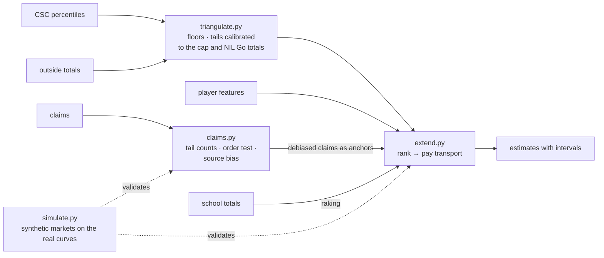

# Estimation

How this repository gets from cohort percentiles to school totals, individual players and the
credibility of reported deals, using only public data. The contracts themselves are private; this
works around that instead of guessing at them.

## What is public, and what each source is for

| Source | What it gives | Used as |
|---|---|---|
| CSC percentiles (this repo's capture) | Every cohort's full pay distribution, official | The anchor: every estimate reproduces it |
| Outside totals: the revenue-share cap, NIL Go's cleared value per period | Ceilings on what a whole report can sum to | Calibrate the unpublished tail past the 90th |
| School disclosures (public records, NCAA financial reports) | A few schools' totals | Aggregate labels for school effects |
| Reported deals (claims) | Named players, mostly stars, noisy and biased | Anchors for those players, and a test of each source |
| Player features (recruiting, portal, usage; CFBD) | Ordering within a cohort | The ranker |

Revenue share and NIL Go are separate reports throughout: nothing compares, joins or adds them.

## Principles

1. **Certain things first.** Before any model: the floors the percentiles imply (each athlete is paid
   at least the published value below him) and the most athletes that can sit above a published
   percentile. These need no assumptions (partial identification).
2. **Calibrated by construction.** A player's estimate is his cohort's quantile at his rank
   (one-dimensional optimal transport), so the estimates reproduce the published distribution
   whatever the ranker. The only thing learned is the ranking.
3. **Aggregates as supervision.** Totals that individual numbers must sum to are training signal:
   the cap and NIL Go's totals fix the tail, and a school's disclosed total fixes its spending effect
   (raking, a form of learning from label proportions).
4. **Noisy labels are measurements.** Each source has a bias; it is estimated from athletes reported by
   more than one source (truth discovery), anchored to school records.
5. **Respect the selection.** Claims cover the stars. Fitting the ranker to them learns what separates
   stars and ranks everyone else worse, and cross-validating on held-out claims can't see the harm,
   because the held-out claims are stars too. Claims are therefore anchors, not training labels.
6. **Validate where the truth is known.** The real contracts are private, so the methods are tested on
   synthetic markets built from the real curves, with ablations and interval calibration.
7. **Two levels of evidence, and every assumption printed.** A claim fails strongly when it fails
   under the most generous tail the totals allow, moderately when only under the central tail.

## The pieces



| Module | What it does |
|---|---|
| `triangulate.py` | Floors on totals; totals under tail scenarios; the tail multiplier at which a report's football total meets its outside constraint |
| `claims.py` | Places each claim on its report's curve; tail counts (no model); the order test (the k-th largest claim against the k-th largest pay, a Beta order statistic) at two levels; source bias by least squares |
| `extend.py` | Rank-to-pay transport per cohort; anchoring claimed players; raking school effects to disclosed totals; rank-uncertainty intervals; optional pairwise ranking weights (RankNet) for claims that cover a whole cohort |
| `simulate.py` | Synthetic A4 football markets and the comparison of methods |

## Results on the 2026-10-30 release

**Triangulation** ([`reports/triangulation_2026-10-30.md`](../reports/triangulation_2026-10-30.md)):

- A4 football revenue share is at least **$11.7M per program** in calendar 2026, **56% of a cap that covers
  every sport**, with no model.
- The fitted lognormal tail would put football at 97% of the cap, and NIL Go football above every sport's
  cleared value through August. Calibrated to the cap (football at 75% of it) and to NIL Go's totals
  (football at 55%), the upper tails are **x0.20 and x0.48** of the fitted slope. The A4 QB 99th percentile
  moves from $9.4M to $2.3M in revenue share, and from $13.6M to $3.5M in NIL. The benchmark, the offer check
  and the dashboard now answer with these tails for A4 football revenue share and all football NIL.

**Simulation** ([`reports/simulation_2026-10-30.md`](../reports/simulation_2026-10-30.md)), 3 markets per
scenario, rank correlation between estimated and true pay:

| | Weak features | Strong features |
|---|---|---|
| Features only | 0.425 | 0.661 |
| Claims as training labels | **0.335** | 0.636 |
| Claims as anchors | 0.437 | 0.664 |
| Anchors + 10 schools' totals (all players) | 0.450 | 0.675 |
| … players at the disclosed schools | 0.511 | 0.732 |

Anchoring leaves unclaimed players exactly where the features put them and cuts the typical miss for
claimed players from x1.99 to x1.09 (weak features) and from x1.27 to x1.10 (strong). The 80% intervals cover
the truth 86–93% of the time, and 89% for claimed players.

**Credibility**, same markets: truth discovery recovers each source's bias (+28% for a +30% outlet, +132%
for a +150% one, 0% for school records). The order test at moderate evidence flags 74 of 75 claims from the
+150% source and 76 of 120 from the +30% outlet. It also flags 29 of 120 from an honest but noisy outlet and
7 of 75 school records, where noise pushed claims above the truth. No claim reaches strong evidence, because
even the most generous tail allows a single quarterback near $11M; that level is reserved for impossible
claims.

## Using it

```bash
nil triangulate                 # reports/triangulation_<date>.md
nil claims my_claims.csv        # columns of data/claims/template.csv; reports/claims_my_claims.md
nil simulate                    # reports/simulation_<date>.md (about 2 minutes)
```

A claims file has one row per reported deal: `report` is `revenue_share`, `nil_go`, or `package` (kept,
never placed); `amount` with `years` for multi-year revenue share; `source_type` is `school_record`,
`reporter`, `agent`, `athlete` or `other`. A `player` name lets the tests count athletes, not claims,
and lets truth discovery compare sources.

## What's next

- **Real features.** A CFBD key brings rosters, recruiting and portal ratings, and usage: the ranker for
  real players. The simulation says what to expect from features of a given quality.
- **Your claims.** The ledger you research goes straight into `nil claims`; sources reporting the same
  athletes, and any school records, make the bias estimates sharp.
- **School totals.** UCLA, Cal and San Diego State's disclosures, and the NCAA financial reports, are
  all-sports totals; raking needs football's share of each, so they enter as ranges.
